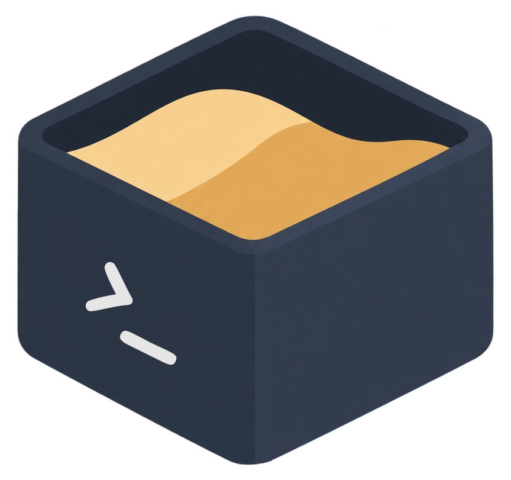

<p align="center">
    
</p>

<h1 align="center"><code>sandbox</code></h1>

<p align="center">
    <strong><code>sandbox</code></strong> • or <strong><code>sb</code></strong> • is a tool for creating and managing isolated local development <i>boxes</i>. It simplifies the process of setting up and maintaining project-specific development environments using reusable and customizable recipes based on Docker images.
</p>

<!-- badges: start -->
<p align="center">
    <a href="https://www.repostatus.org/#active"></a>
    <a href="https://github.com/mihaiconstantin/sandbox/releases"></a>
</p>
<!-- badges: end -->

## Motivation

The primary motivation for `sb` is to provide a simple way to run tools,
scripts, and AI agents inside controlled environments rather than directly on
the host operating system, while abstracting away much of the underlying
complexity. Each box is built from a catalogue recipe and is associated with a
project directory on the host filesystem. Check out the documentation and guide
at [sandbox.mihaiconstantin.com](https://sandbox.mihaiconstantin.com) for more
details.

## Requirements

To use `sb` you need the following:

- [Python](https://www.python.org/) `3.11` or newer
- [Docker Engine](https://docs.docker.com/engine/install/) with
  [Compose](https://docs.docker.com/compose/) `5.6.0` or newer and
  [Buildx](https://docs.docker.com/reference/cli/docker/buildx/) `0.17.0` or
  newer
- [`uv`](https://docs.astral.sh/uv/) for easy installation and upgrade

Before running commands, `sb` checks and reports a missing or unsupported tool
with the required version. It, however, never installs other tools on your host.

> [!WARNING]
>
> `sb` provides convenience for local development. It is not intended as a
> security boundary to contain unsupervised rouge AI agents or other untrusted
> workloads. See [NVIDIA/OpenShell](https://github.com/NVIDIA/OpenShell) for a
> production-oriented solution in that direction. Micro VM support for better
> isolation and security is on the roadmap of `sb`.

## Install

You can install `sb` using `uv` from the GitHub repository using:

```bash
# Install the tool from the repository.
uv tool install git+https://github.com/mihaiconstantin/sandbox.git
```

At the point, `sb` is available in your path. You can verify the installation by
printing the installed version:

```bash
# Print the installed version.
sb --version
```

You can upgrade an existing installation by running:

```bash
# Upgrade the installed tool.
uv tool upgrade sandbox
```

To quickly get started, you can check out the CLI guide as show below, or check
out the [documentation](https://sandbox.mihaiconstantin.com).

```bash
# Print the getting started guide.
sb guide
```

## Contributing

- Any contributions are welcome and greatly appreciated. Please open a [pull
  request](https://github.com/mihaiconstantin/sandbox/pulls) on `GitHub`.
- To report bugs, or request new features, please open an
  [issue](https://github.com/mihaiconstantin/sandbox/issues) on `GitHub`.

## License

The package source code in this repository is licensed under the [MIT
license](https://opensource.org/license/mit).
